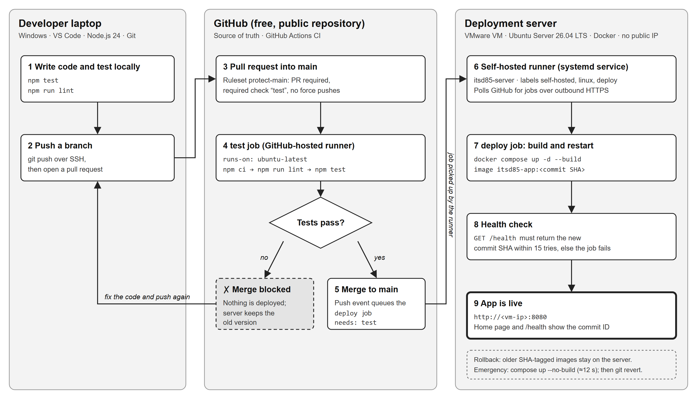

# ITSD 85 Lab 6: Automated CI/CD Pipeline
Student(s): Ethan Campomanes   Section: BSIT 4C   Instructor: <name>

## What this project does
A small Node.js web API (Express) that is automatically linted, tested and deployed. Every push or pull request to `main` runs the tests on GitHub's free cloud runner. When the tests pass on `main`, a self-hosted runner on my own Ubuntu server rebuilds the Docker container and checks that the new version is live. The commit ID of each release is shown on the home page and on `/health`, so every deploy can be traced to a commit.

| Endpoint | Returns |
|---|---|
| `GET /` | Home page with the deployed version (commit ID) |
| `GET /health` | `{"status":"ok","version":"<commit ID>"}` |
| `GET /api/add?a=2&b=3` | `{"result":5}` (400 if `a` or `b` is not a number) |

All tools are free: Git, Node.js 24, the `node:test` runner, ESLint, GitHub Actions (cloud runner + self-hosted runner), VMware Workstation, Ubuntu Server 26.04 LTS, Docker Engine and Docker Compose.

## Pipeline diagram


## How to run locally
Requires Node.js 24.
```bash
npm install          # install dependencies
npm run lint         # ESLint – no output means no problems
npm test             # node:test – expect pass 3, fail 0
npm run dev          # http://localhost:3000 and http://localhost:3000/health
```
With Docker:
```bash
APP_VERSION=local docker compose -p itsd85 up -d --build   # http://localhost:8080
docker compose -p itsd85 down
```

## How the deployment works
The workflow is [.github/workflows/ci-cd.yml](.github/workflows/ci-cd.yml) and has two jobs.

1. **test** runs on `ubuntu-latest` (GitHub-hosted) for every push and pull request to `main`: `npm ci` → `npm run lint` → `npm test`.
2. **deploy** runs on the self-hosted runner `itsd85-server` (labels `self-hosted, linux, deploy`). It runs only when:
   - `needs: test` – the test job passed (the quality gate), and
   - the event is a push to `main` – pull requests are tested but never deployed.

   Steps: check out the code → `docker compose -p itsd85 up -d --build` with `APP_VERSION` set to the commit SHA (the image is tagged with it) → health check: `/health` must return the new commit ID within 15 tries, or the job fails and prints the container logs → `docker image prune -f`.

The server is a VMware Workstation VM (NAT, no public IP). The runner connects **out** to GitHub to ask for jobs, so no open ports, port forwarding or SSH keys in GitHub are needed. A `concurrency: production` group prevents two deploys from running at the same time.

**Branch protection:** the `protect-main` ruleset requires a pull request and a passing `test` check before merging, and blocks force pushes.

**Rollback:**
- *Method 1 (recommended):* `git revert` the bad merge, open a PR, merge – the pipeline redeploys the old code as a new version.
- *Method 2 (emergency, seconds):* on the server, start the image of a previous commit without rebuilding:
  `APP_VERSION=<previous-commit-id> docker compose -p itsd85 up -d --no-build` – then still do Method 1.

## Results
Push-to-live time = time from the merge (push to `main`) until the deploy job's health check passes.

| Test | Expected result | Actual result | Push-to-live (min:sec) |
|---|---|---|---|
| A – good change | test ✓, deploy ✓, new name and commit ID live | test 7 s ✓, deploy 39 s ✓; name and `bc6c3ed` live | 0:53 |
| B – broken change | test ✗, merge blocked, server unchanged | test ✗ (`add()`: `-1 !== 5`), merge blocked, server stayed on `bc6c3ed` | n/a |
| C – rollback (Method 1) | old content and a new commit ID live | revert merged; old title live as `ff4da10` | 1:08 |
| C – rollback (Method 2) | previous commit ID live within seconds | `bc6c3ed` live again, no rebuild | 0:12.4 |

## Screenshots
All in [docs/screenshots/](docs/screenshots/).

| # | Checkpoint | File |
|---|---|---|
| 1 | Tool versions and SSH login to GitHub | [cp1-versions.png](docs/screenshots/cp1-versions.png) |
| 2 | 3 passing tests and the app running locally | [cp2-tests-and-dev-server.png](docs/screenshots/cp2-tests-and-dev-server.png) |
| 3 | Repository file list on GitHub | [cp3-repo-files.png](docs/screenshots/cp3-repo-files.png) |
| 4 | Green CI test job | [cp4-ci-green.png](docs/screenshots/cp4-ci-green.png) |
| 5 | Docker on the server and the manual deploy | [cp5-hello-world.png](docs/screenshots/cp5-hello-world.png) |
| 6a | Self-hosted runner Idle with the `deploy` label | [cp6a-runner-idle.png](docs/screenshots/cp6a-runner-idle.png) |
| 6b | Green test → deploy run | [cp6b-deploy-green.png](docs/screenshots/cp6b-deploy-green.png) |
| 6c | Live commit ID matches GitHub | [cp6c-commit-live.png](docs/screenshots/cp6c-commit-live.png) |
| 7A | Test A – PR checks green; change live | [t7a-pr-green.png](docs/screenshots/t7a-pr-green.png), [t7a-live.png](docs/screenshots/t7a-live.png) |
| 7B | Test B – failing test; merge blocked; server unchanged | [t7b-test-failed.png](docs/screenshots/t7b-test-failed.png), [t7b-merge-blocked.png](docs/screenshots/t7b-merge-blocked.png), [t7b-server-unchanged.png](docs/screenshots/t7b-server-unchanged.png) |
| 7C | Test C – bad release live; Method 2 rollback; revert PR; Method 1 redeploy | [t7c-broken-live.png](docs/screenshots/t7c-broken-live.png), [t7c-method2-rollback.png](docs/screenshots/t7c-method2-rollback.png), [t7c-revert-pr-green.png](docs/screenshots/t7c-revert-pr-green.png), [t7c-method1-revert.png](docs/screenshots/t7c-method1-revert.png) |

## Paper
[docs/paper.pdf](docs/paper.pdf) – IEEE conference paper. LaTeX source: [docs/paper/paper.tex](docs/paper/paper.tex) (build with `tectonic docs/paper/paper.tex`).
